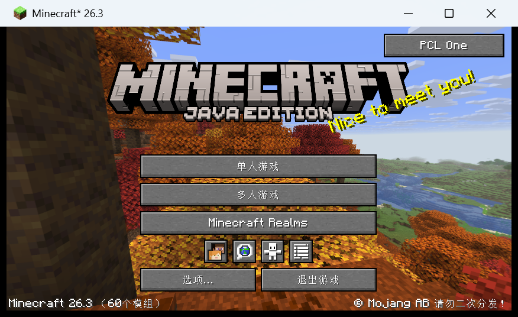
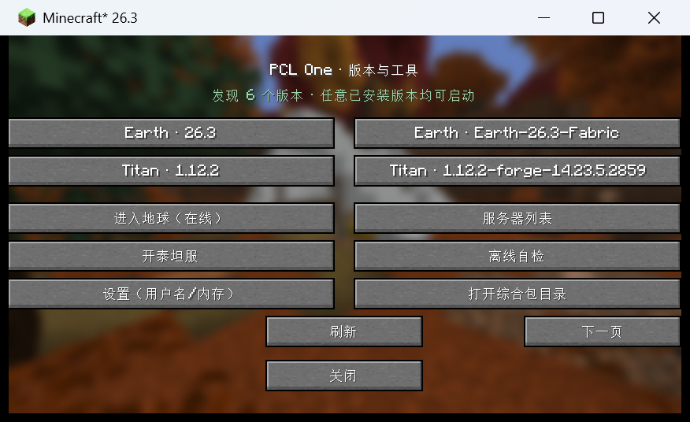
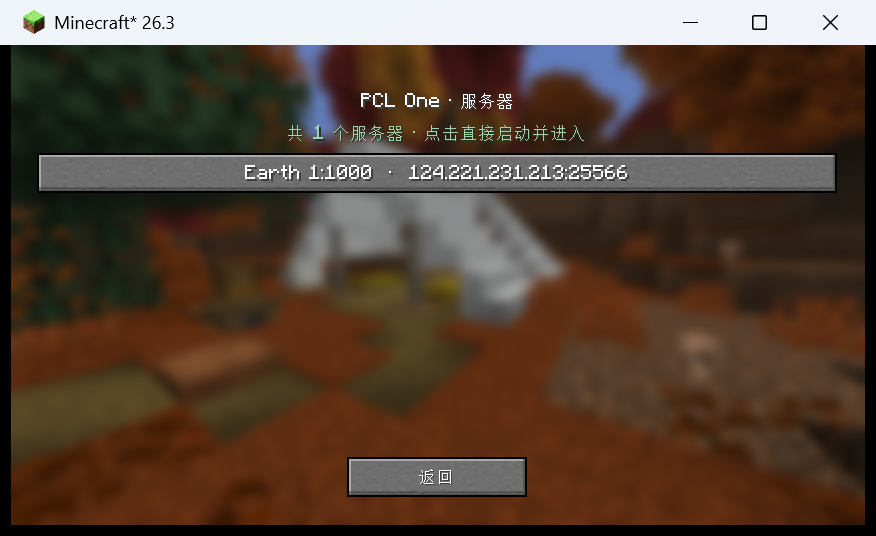

# PCL One

**Minecraft Java Edition, offline, with the launcher living inside the game's own menu.**

[English](README.md) · [Chinese (Simplified)](README.zh-CN.md)


PCL One is a self-contained Minecraft distribution. Install it once, double-click, play. The
package carries its own game runtimes, Java runtimes, mods and a 1.7.10 Forge server, and it adds
exactly one thing to Minecraft: a **PCL One** button in the top-right corner of the title screen.
That button *is* the launcher. It lists every installed instance, joins the Earth server, starts
Titan 1.7.10 or 1.12.2, starts the bundled server, edits the username and memory settings, and
runs a 25-point self-test.

No third-party launcher window ships in the package: no PCL, PCL2 or PCL Pro UI, no download page,
no updater, no install wizard. Starting a game is a windowless process that reads a version JSON,
builds a classpath and calls `java.exe`.

## Screenshots

| Title screen | PCL One menu | Server list |
|---|---|---|
|  |  |  |

Screenshots were taken on Minecraft 26.3 with the full mod set loaded. The menu is built with
fixed labels, which are currently Chinese; the launcher itself is language-neutral.

## What is in the package

| Component | Contents |
|---|---|
| **Earth 26.3** | Minecraft 26.3 + Fabric client for the 1:1000 Earth server, including assets, libraries and 8 curated mods; bundled JDK 25 |
| **Titan 1.7.10** | Forge 10.13.4.1614 client for the Titan modpack (TheTitans / Techguns) with a bundled Java 8 runtime |
| **Titan 1.12.2** | Forge 14.23.5.2859 client for Titan on 1.12.2, same bundled Java 8 |
| **Titan server** | A 1.7.10 Forge dedicated server plus world, started from the same menu |
| **`pcl-one-menu`** | A small Fabric client mod that adds the title-screen button. No Mixin, no patching of game files |
| **`PCL One.exe`** | The windowless launcher: version JSON → classpath → `java.exe` |
| **Six shortcuts** | Optional `.lnk` entries, one per action, each passing a single argument |
| **Single-file installer** | A silent self-extractor (~1.1 GB) with no wizard and no progress window |

## The in-game menu

The menu is one screen, opened from the title screen. It contains:

| Entry | Action |
|---|---|
| **Installed versions**, four per page | Every `<root>/.minecraft/versions/<id>/<id>.json` found in `Earth`, `Titan`, any sibling folder with a `.minecraft` directory, and any `games.txt` entries |
| **Enter Earth (online)** | Calls the vanilla `ConnectScreen` against the Earth server |
| **Server list** | Reads `servers.txt` (one pipe-separated line per server: name, address, gameDir, instance), lists the entries and connects on click |
| **Start Titan server** | `PCL One.exe server` |
| **Offline self-test** | `PCL One.exe selftest`; writes `PCLOne-selftest.txt` |
| **Settings** | Username (3–16 characters, `A-Z a-z 0-9 _`) and memory in MB, stored in `PCLOne-settings.json` |
| **Open package folder** | Opens the package root in Explorer |
| **Refresh / previous / next / close** | Navigation, paging and dismissal |

How it works:

- The mod subscribes to `ScreenEvents.AFTER_INIT` from the Fabric Screen API and adds one button
  to the vanilla `TitleScreen` through a single reflective `addRenderableWidget` call.
- Buttons either call a vanilla screen (`ConnectScreen`, the mod's own screens) or shell out to
  `PCL One.exe <argument>` via `ProcessBuilder`; the launcher process opens no window.
- A menu failure writes `PCLOne-menu.log` and never takes the game down. If the mod fails to load
  entirely, the desktop shortcuts still work.
- The mod depends only on Fabric API's screen modules, so the build needs no Gradle:
  `tools/build-menu-mod.ps1` compiles it with the bundled JDK 25's `javac` against the 26.3 client
  jar and the screen/base modules extracted from `fabric-api-*.jar`.

## Quick start

### Windows

Download from [Releases](https://github.com/yangtianyi117-maker/PCL-One/releases/latest):

| Asset | Size | Purpose |
|---|---|---|
| `PCL.One.6.0.0.exe` | ≈ 1.1 GB | Single file: silent extraction + launch |
| `PCL.One.6.0.0.zip` | ≈ 1.1 GB | Portable folder |
| `PCL-One-Server-6.0.0.zip` | — | The 1.7.10 Forge server on its own |
| `PCLProMobile-2.1.0.apk` | — | Optional Android link helper |
| `SHA256SUMS-PCL-One-6.0.0.txt` | — | Checksums for the above |

1. Double-click `PCL.One.6.0.0.exe`. It extracts a `PCL One` folder next to itself (or into
   `%LOCALAPPDATA%\Programs` when the location is read-only) and starts the game. There is no
   dialog, no wizard and no progress window; progress goes to `PCLOne-sfx.log`.
2. Re-running the same version skips extraction and just launches. Overwriting an older version
   replaces files in place and never touches saves.
3. In Minecraft, click **PCL One** in the top-right corner and pick a version.

The installer also accepts `--verify`, `--verify-full`, `--extract <dir>` and `--version`.

### Phone

No app is required. Add a server in the official Minecraft Bedrock edition:

```
124.221.231.213:19132
```

Bedrock and Java players share the same world through Geyser and Floodgate. An optional Android
helper (server list, one-tap join, LAN discovery, room codes) lives in [`mobile/link`](mobile/link)
and ships as `PCLProMobile-2.1.0.apk`; its source is also mirrored to
[PCL-Mobile-Link](https://github.com/yangtianyi117-maker/PCL-Mobile-Link).

## Command line

`PCL One.exe` never opens a window. The first argument selects the action; with no argument it
starts Earth.

| Command | What it does |
|---|---|
| *(none)* / `earth` | Launch Earth and join the server (falls back to single-player when offline) |
| `earth-local` | Launch the Earth client without joining a server |
| `titan1710` | Launch Titan 1.7.10 |
| `titan1122` | Launch Titan 1.12.2 |
| `server` | Start the 1.7.10 Forge server |
| `selftest` | Run the 25-point offline self-test |
| `versions` | Scan installed instances and write `PCLOne-versions.txt` |
| `plan <target>` | Resolve a launch without starting it (`earth`, `titan1710` or `titan1122`); writes `PCLOne-plan.txt` |
| `launch <gameDir> <instance> [address] [--java path] [--memory MB] [--username name]` | Launch any instance in any game directory |
| `version` | Record the launcher identity in `PCLOne-last.txt` and exit |

Examples:

```powershell
# List every instance the menu would show
PCL One.exe versions

# Launch a custom instance, joining a server with 6 GB of memory
PCL One.exe launch Earth\.minecraft MyFabricInstance 1.2.3.4:25565 --memory 6144 --username Steve

# Launch an instance outside the package
PCL One.exe launch D:\mc 1.20.1
```

Output and state are plain files next to the launcher: `PCLOne-last.txt` (last command and
status), `PCLOne-error.txt` (failures), `PCLOne-selftest.txt`, `PCLOne-plan.txt` and
`PCLOne-launch.log`. Settings live in `PCLOne-settings.json`.

## Using your own instances

The menu is not hard-wired to Earth and Titan. Any game directory with a standard
`.minecraft/versions` layout is picked up:

- inside the package: `Earth\.minecraft`, `Titan\.minecraft`, or any sibling folder that contains
  a `.minecraft` directory;
- outside the package: one `Name|Path` line per directory in `games.txt` (absolute, or relative to
  the package).

Java is chosen from the version JSON's `javaVersion.majorVersion` (26.3 → 25, 1.7.10 / 1.12.2 → 8)
by looking in `<gameDir>\runtime`, a sibling `java\` directory, then the bundled JDKs. `--java`
overrides the choice.

If a launch requests a server that does not answer within 1.2 seconds, the launcher drops the
server argument and starts single-player instead, recording `status=offline-fallback`.

## How a launch works

```text
versions/<id>/<id>.json  (following inheritsFrom)
  ├─ rules-filtered libraries        → classpath
  ├─ natives classifiers             → extracted
  ├─ offline account UUID / token    → OfflinePlayer:<name>, v3 UUID
  └─ java.exe <jvm args> -cp ... <mainClass> <game args>
```

That is the entire launch engine, about 650 lines in [`launcher/McLaunch.cs`](launcher/McLaunch.cs).
It is verifiable without playing: `--plan` prints the resolved main class, Java version and jar
count for each target.

## Repository layout

```text
PCL-One/
├─ pcl-one.json              # single product config: hosts, ports, instances, versions, Java
├─ build.ps1                 # single build entry: menu mod + shell + payload + zip + single exe
├─ launcher/                 # windowless launcher (PCLOne.cs, McLaunch.cs, PCLOneSetup.cs)
├─ menu/                     # in-game Fabric menu mod (no Mixin)
├─ earth/                    # Earth client installer, server config, docs, acceptance tests
├─ mobile/
│  ├─ link/                  # Android link helper (APK sources)
│  └─ pojav/                 # PojavLauncher fork, independent Android Java launcher
├─ custom/                   # PCL Custom launcher sources (a PCL CE derivative)
├─ generated/                # build-time generated config, SfxInfo, OfficialServers
├─ tools/                    # menu build, Earth offline packaging, config generation
├─ shared/                   # mod list and shared data
├─ docs/                     # design, offline and migration notes
├─ vendor/                   # binaries from your own copies of MC / JDKs / server (not tracked)
└─ dist/                     # build output (not tracked)
```

## Building from source

Requirements:

- Windows x64 (the build uses the .NET Framework `csc.exe` that ships with Windows, `.lnk`
  shortcuts and Explorer integration);
- a `vendor/` tree with your own copies of the game files: Earth 26.3 + Fabric client, Titan
  1.7.10 and 1.12.2 clients, the 1.7.10 Forge server, JDK 25 and Java 8. These binaries are not in
  the repository;
- the bundled JDK 25 for compiling the menu mod.

```powershell
# Full build, then run the offline self-test against dist/
powershell -NoProfile -ExecutionPolicy Bypass -File .\build.ps1 -Verify

# Build without zip and single-file exe
.\build.ps1 -SkipZip
```

Build order: generate configs → compile the in-game menu mod → compile the shell → stage Earth,
Titan and Server → write shortcuts → self-test → zip → single-file exe.

Two helpers make the offline claim testable rather than aspirational:

- `tools/prepare-earth-offline.ps1` rebuilds the Earth payload from any `.minecraft` directory;
- `tools/offline-smoke.ps1` starts the game using only files inside the package, with no network
  downloads.

## Verifying a build

```powershell
PCL One.exe --selftest        # 25 checks: plans, assets, mods, menu mod, Java, files
PCL One.exe --plan earth      # 82 jars
PCL One.exe --plan titan1710  # 49 jars
PCL One.exe --plan titan1122  # 54 jars
```

The self-test also asserts what should *not* exist: no `PCLPro` folder, no PCL2 executable and no
stray `.bat` outside the server folder.

## Design notes

PCL One treats the package as a **distribution**, not a single runtime. The invariants:

1. **One entry point.** The user only needs to know `PCL One.exe` — or the button in the menu.
2. **Runtime isolation.** Earth and Titan keep separate game directories, launchers, Java
   versions and mods; neither writes into the other.
3. **Reversible.** Every writable file stays inside the package folder (the single-file installer
   falls back to `%LOCALAPPDATA%\Programs` only when its own folder is read-only), so deleting the
   folder removes the installation.
4. **Offline by construction.** The launch path performs zero downloads. The network is used for
   exactly one thing: reaching the Earth server.
5. **Compliance first.** World files are never shipped. The 1:1000 map license requires the world
   to stay server-side, and the client package contains no `region/`, `level.dat` or `.mca` files.

Merging the two runtimes into one game directory is not possible in practice: Java 25 versus
Java 8, Fabric versus Forge 10.13.4, LWJGL 3 versus LWJGL 2, and two incompatible config models.
The package therefore merges **entry points and distribution**, not **runtimes**. See
[`docs/DESIGN.md`](docs/DESIGN.md) for the full argument, including why every launcher UI was
removed in 3.0.0 and why the remaining features moved into the game in 6.0.0.

## Scope

- The desktop shell is Windows x64 only.
- The in-game menu exists for the Fabric 26.3 client. Titan runs Forge and has no equivalent
  menu; it is started from the same menu or from a shortcut.
- PCL One is not a general-purpose launcher: no instance creation wizard, no mod downloads, no
  modpack import, no Microsoft account login. Accounts are offline (`OfflinePlayer:<name>`).
- Earth is a public server and the only component that needs the network. Offline, Earth starts
  in single-player.
- The mobile side is the official Bedrock client plus an optional helper app; no mobile runtime is
  bundled in the package.

## Status

Version 6.0.0, built 2026-11-23. Verification evidence from the build session:

- the game log shows `pcl-one-menu 1.0.0` loaded with no errors;
- the title screen shows the PCL One button, and the menu renders correctly (screenshots above);
- menu → offline self-test writes `command=selftest status=ok`;
- menu → Titan 1.7.10 starts a Java process with 49 jars and keeps running;
- menu → Enter Earth opens the vanilla connecting screen;
- `--plan` resolves 82 / 49 / 54 jars for Earth, Titan 1.7.10 and Titan 1.12.2.

Known limits: the menu is Chinese-only; the single-file installer logs instead of showing errors;
the Earth map cannot be redistributed, so the package is not a complete offline copy of the server.

## Documentation

- [`docs/DESIGN.md`](docs/DESIGN.md) — why one shell and two runtimes, and the removal of every launcher UI
- [`docs/OFFLINE.md`](docs/OFFLINE.md) — the offline contract, menu behaviour and directory layout
- [`docs/MIGRATION.md`](docs/MIGRATION.md) — how the old folder layout maps onto this repository
- [`earth/docs/PRODUCT.md`](earth/docs/PRODUCT.md) — the Earth server's product definition
- [`mobile/link/docs/MULTIPLAYER.md`](mobile/link/docs/MULTIPLAYER.md) — the three mobile connection paths

## Licensing and third-party notices

Licensing is per component; each part keeps its own terms:

- `custom/` contains sources derived from [PCL CE](https://github.com/PCL-Community/PCL-CE) and
  [PCL](https://github.com/Meloong-Git/PCL) (by Longteng Maoyue). `PCL.Core/` is Apache-2.0;
  `Plain Craft Launcher 2/` is covered by the PCL custom license. Read the license files in those
  directories before redistributing.
- `mobile/link` is GPL-3.0 (see [`mobile/link/LICENSE`](mobile/link/LICENSE)); `mobile/pojav` is a
  fork of [PojavLauncher](https://github.com/PojavLauncherTeam/PojavLauncher), also GPL-3.0.
- The Earth server bundles third-party plugins (Paper, Geyser, Floodgate, Towny, BlueMap,
  CoreProtect, EssentialsX, LuckPerms, ViaVersion and others), each under its own license. See
  [`earth/docs/LICENSES.md`](earth/docs/LICENSES.md) for the inventory.
- Minecraft, the game assets and the EarthMC map are **not** licensed by this project. The
  repository tracks no game binaries, JDKs or world files; builds use your own `vendor/` copies,
  and the map license forbids redistributing the world.
- Not affiliated with Mojang, Microsoft or EarthMC. "Minecraft" is a trademark of Mojang Synergies
  AB. Obey the Minecraft EULA and your local laws.

## Credits

- [PCL](https://github.com/Meloong-Git/PCL) and [PCL CE](https://github.com/PCL-Community/PCL-CE) —
  the launcher heritage that made this project possible;
- [EarthMC](https://earthmc.org) for the 1:1000 Earth map;
- [Fabric](https://fabricmc.net), [Forge](https://files.minecraftforge.net),
  [Paper](https://papermc.io), [Geyser](https://geysermc.org) and
  [Floodgate](https://geysermc.org/wiki/floodgate/) for the runtimes and cross-play;
- [PojavLauncher](https://github.com/PojavLauncherTeam/PojavLauncher) for the Android fork;
- Mojang and Microsoft for Minecraft.
