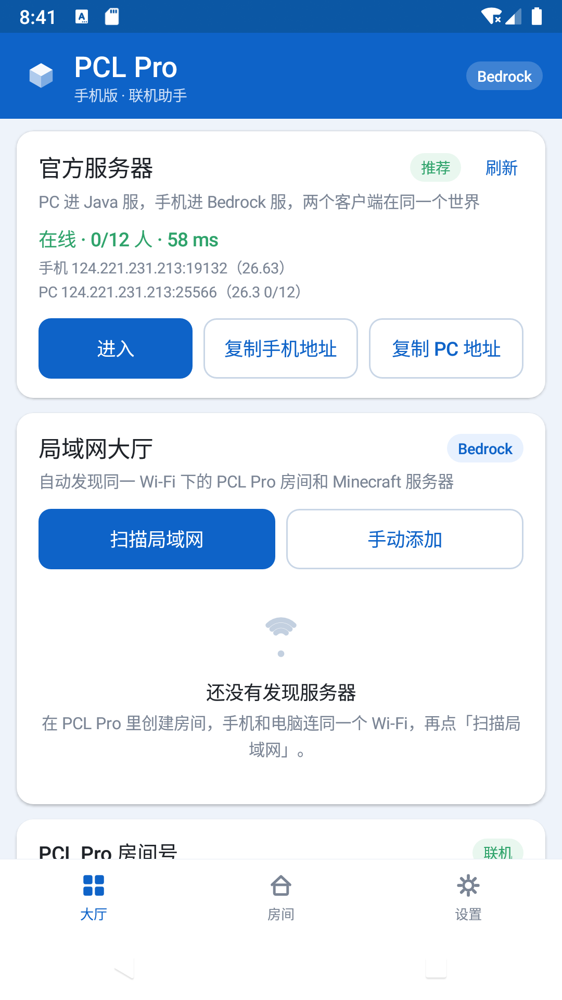
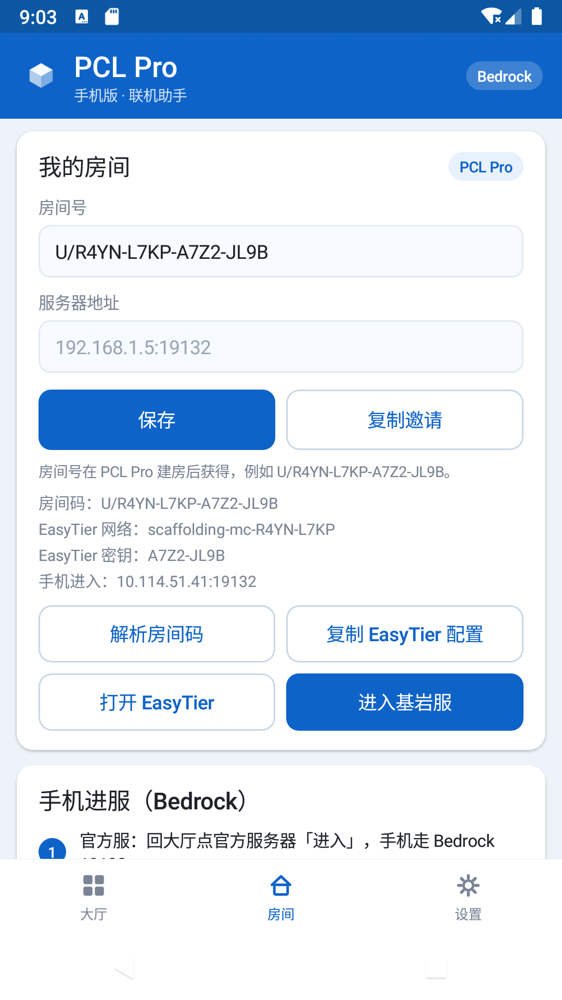

# PCL Pro 手机版（Android）· PCL-Mobile-Link

> PCL One 的手机联机助手：进固定地球服、同 Wi-Fi 发现 PCL 基岩桥、用房间码加入 EasyTier 房间。
> 桌面端源码：[PCL-One](https://github.com/yangtianyi117-maker/PCL-One)


- 包名：`com.pclpro.mobile`
- 版本：`2.1.0 (versionCode 4)`
- 最低系统：Android 7.0（API 24），目标 API 34
- 依赖：**零第三方依赖**（无 AndroidX / 无 Gradle），仅用 Android Framework

| 官方服 | 房间码 |
|---|---|
|  |  |

## 2.1.0 联机能力

| 能力 | 说明 |
|---|---|
| 地球服 | 手机 Bedrock `124.221.231.213:19132`，与 PC Java `124.221.231.213:25566` 同一张 1:1000 地球地图；显示在线人数/延迟 |
| 地球指南（离线） | 指南随 APK 打包为 `app/assets/earth.html`，在 App 内 WebView 打开；没有网络也能看规则/坐标，浏览器打开才走公网 |
| 一键进入 | `minecraft://connect?...` 深链；失败回退打开 Minecraft；最后回退复制地址 |
| 局域网 | `/24` 扫描 + Bedrock 广播；PC 启动基岩桥后同一 Wi-Fi 可发现 |
| 房间码 | 输入 `U/XXXX-XXXX-XXXX-XXXX`，派生 EasyTier 网络名/密钥，复制配置、打开 EasyTier、进 `10.114.51.41:19132` |
| 邀请深链 | `pclpro://join?c=...&n=...&s=...&h=...&p=...` 自动填房间页 |

完整三条链路（A 固定服 / B 同 Wi-Fi / C 房间码）见 [docs/MULTIPLAYER.md](docs/MULTIPLAYER.md)。

## 构建

```powershell
# 产物：dist\PCLProMobile-<version>.apk
powershell -NoProfile -ExecutionPolicy Bypass -File .\build.ps1 -Release -VersionName 2.1.0 -VersionCode 4
```

构建链：`aapt2 compile/link` → `javac` → `d8` → `zipalign` → `apksigner`，
只用 JDK 17 + Android build-tools，不需要 Gradle。

## 安装

```powershell
adb install -r dist\PCLProMobile-2.1.0.apk
```

或把 APK 发到手机，允许未知来源后安装。

## 目录

```text
app/                     # APK 源码（无 AndroidX）
  assets/earth.html      # 离线地球指南（由桌面端 gen-config 生成）
  src/com/pclpro/mobile/ # Activity / 扫描 / ping / UI
build.ps1                # aapt2 + javac + d8 + apksigner
OfficialServers.java.tpl # 由 pcl-one.json 生成的服务器常量模板
docs/                    # 联机设计、截图
tools/                   # 辅助脚本（PingTest、假基岩服）
```

## 许可

见 [LICENSE](LICENSE) 与 [NOTICE.md](NOTICE.md)。Minecraft 为 Mojang/Microsoft 商标，本项目非官方。
